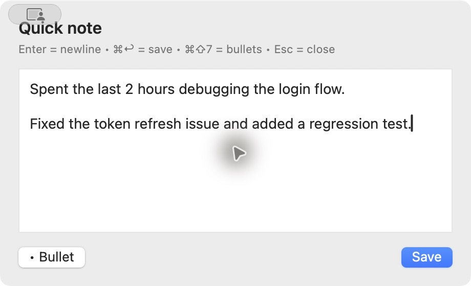
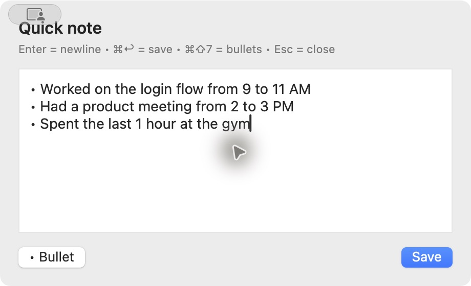
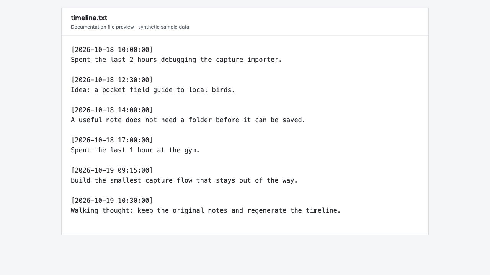
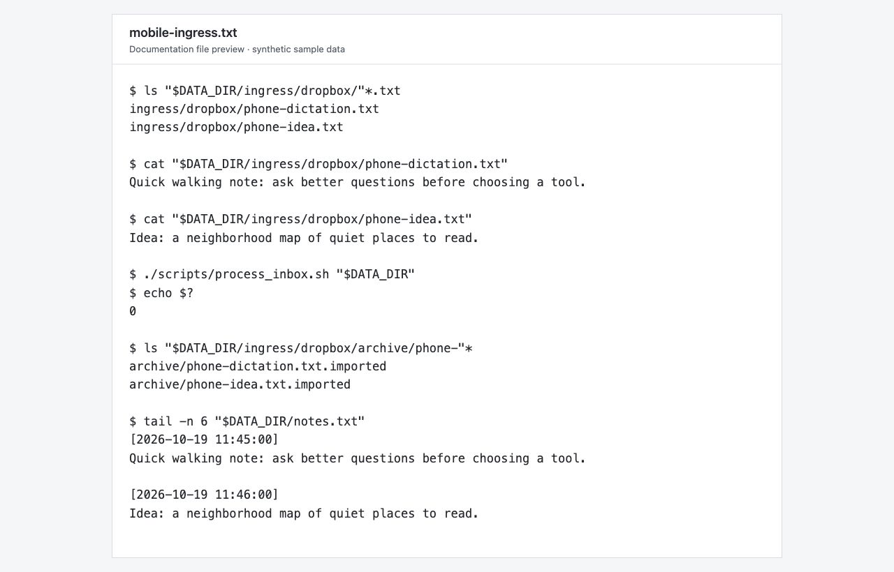
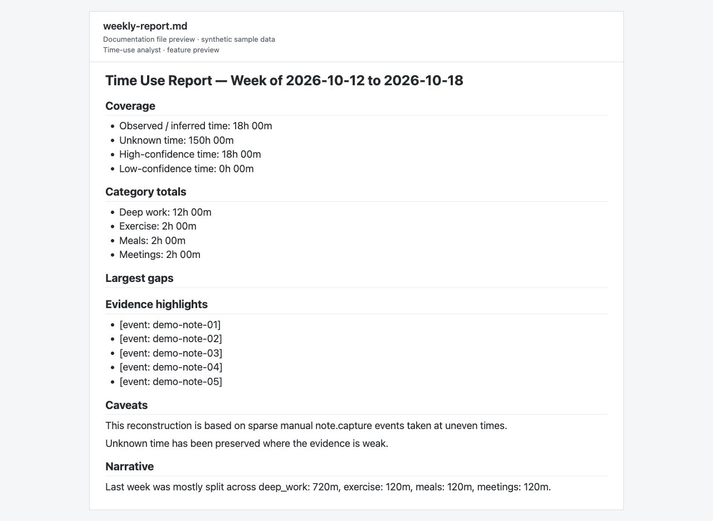
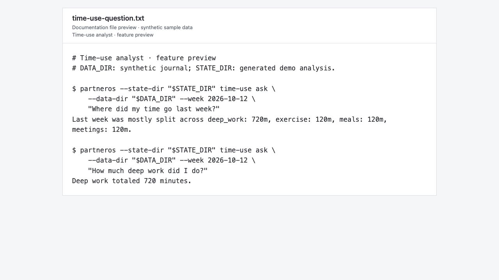

# partnerOS

**Quick capture on Mac. One timeline for laptop and phone notes.**

partnerOS starts with **notesCapture**: a small native macOS window for getting a thought, work log, or reminder out of your head. Open it with **Option + Space**, type, and save with **Command + Enter**. Notes from your Mac and an iPhone Shortcut can flow into the same readable `notes.txt` timeline.

All screenshots below use synthetic demo notes. The capture workflows are available on `main`; the time-use analysis at the end is a feature-branch preview. File previews display actual generated output in a simple documentation viewer.

## Capture without breaking your flow

<table>
  <tr>
    <td width="50%"><strong>A quick thought</strong></td>
    <td width="50%"><strong>A few bullets</strong></td>
  </tr>
  <tr>
    <td><a href="docs/screenshots/01-quick-note.jpg"></a></td>
    <td><a href="docs/screenshots/02-bullet-notes.jpg"></a></td>
  </tr>
  <tr>
    <td>Press <strong>⌥ Space</strong> to open, <strong>⌘ Enter</strong> to save, or <strong>Esc</strong> to close.</td>
    <td>Use <strong>⌘ Shift 7</strong> or the <strong>• Bullet</strong> button. Enter continues the list.</td>
  </tr>
</table>

## Read everything in one timeline

Each capture becomes an immutable plain-text file. The importer rebuilds `notes.txt` in chronological order, so quick thoughts and longer notes stay together in a file you can open in your preferred editor.

<a href="docs/screenshots/03-merged-timeline.jpg"></a>

`notes.txt` is generated from the saved entries. Keep the original captures in `entries/` as the source of truth.

## Add a note from your phone

An iPhone or iPad Shortcut asks for text or dictation and saves a `.txt` file into Dropbox's `ingress/dropbox/` folder. When the file reaches your Mac, the importer saves an entry and refreshes the same timeline.

<a href="docs/screenshots/04-mobile-ingress.jpg"></a>

*The screenshot shows the desktop import pipeline. Phone capture uses Apple Shortcuts and Dropbox.* See the [iPhone setup guide](mobile/ios/README.md); running setup also generates machine-specific instructions in `mobile/ios/SHORTCUT_SETUP.txt`.

## Preview: understand where your week went

The [time-use analysis branch](https://github.com/no4jargon/partnerOS/tree/feat/events-agents-time-use-mvp/partnerOS/eventsAgents), tracked in [PR #5](https://github.com/no4jargon/partnerOS/pull/5), adds a journal-based storage layer and a separate, read-only analyst. These features are **in development and are not included in `main`**.

### A weekly report grounded in your notes

The analyst extracts time-related evidence from captured notes and writes a weekly Markdown report with category totals, confidence, source references, and explicit unknown time. Sparse notes leave gaps in coverage.

<a href="docs/screenshots/05-weekly-report.jpg"></a>

*This is generated Markdown displayed in a document viewer.*

### A scoped question from the command line

After building the weekly analysis, ask supported questions such as how much deep-work time was recorded.

<a href="docs/screenshots/06-time-use-question.jpg"></a>

See the [analysis README](https://github.com/no4jargon/partnerOS/blob/feat/events-agents-time-use-mvp/partnerOS/eventsAgents/README.md) for its commands, limits, and optional OpenAI-backed extraction.

## Get started on macOS

Requirements: macOS, Python 3, the Swift compiler (`swiftc`), and Hammerspoon. Dropbox is optional for Mac-only capture and recommended for phone capture. Setup can install Hammerspoon through Homebrew if needed.

```bash
git clone https://github.com/no4jargon/partnerOS.git
cd partnerOS
./setup.sh
```

Setup builds the Swift helper, configures Hammerspoon and the importer, chooses a data directory, and generates the iPhone Shortcut instructions. It prefers Dropbox when available and otherwise uses the repository's `data/` folder.

You can choose the location explicitly:

```bash
./setup.sh --use-repo-data
# Or:
./setup.sh --data-dir /path/to/your/notes-data
```

If `swiftc` is missing, install Apple's Command Line Tools with `xcode-select --install`.

Once set up:

1. Press **Option + Space**.
2. Type your note; Enter adds a new line.
3. Press **Command + Enter** to save.
4. Open `notes.txt` in your configured data directory to read the timeline.

## How the current capture app works

```text
Mac quick note ──→ ingress/local/   ──┐
                                    ├──→ importer ──→ entries/ ──→ notes.txt
iPhone Shortcut → ingress/dropbox/ ──┘
```

The current data layout is:

```text
<data-directory>/
├── ingress/
│   ├── local/                 # Raw Mac captures
│   └── dropbox/               # Raw phone captures
├── entries/YYYY/MM/DD/        # Immutable saved notes
└── notes.txt                  # Generated timeline
```

Producers write one raw text file per capture into `ingress/`. The importer creates canonical entries and archives the raw input. The materializer regenerates the readable timeline from those entries. Dropbox provides transport between devices.

The [v2 architecture](docs/architecture-v2.md) and [capture-event-v1 contract](docs/capture-event-v1.md) describe the planned move to a canonical event journal. The time-use preview builds on that work.

## Development and project files

```text
partnerOS/
├── quicknote.swift           # Native Mac capture window
├── hammerspoon/              # Global hotkey integration
├── scripts/                  # Import and materialization
├── mobile/ios/               # Shortcut setup guide
├── docs/                     # Architecture and event contract
├── tests/                    # Capture pipeline checks
└── setup.sh                  # Local installation
```

Run the checks before opening a pull request:

```bash
./tests/run_all.sh
```

See [CONTRIBUTING.md](CONTRIBUTING.md) for the PR workflow and [.github/workflows/pr-checks.yml](.github/workflows/pr-checks.yml) for CI. Local binaries, configuration, data, and generated Shortcut instructions are gitignored.

[MIT license](LICENSE).
